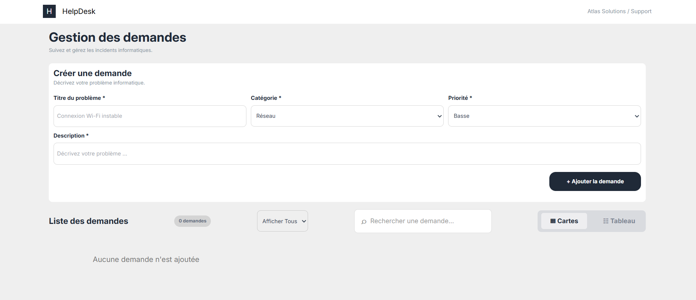

# 🛠️ HelpDesk — Gestion interactive des demandes de support

Application web interactive permettant d'enregistrer, d'afficher et de gérer des demandes de support informatique pour **Atlas Solutions**, une entreprise fictive de services numériques.

🔗 **Démo en ligne :** [https://abdessamadamimi.github.io/HelpDesk/](https://abdessamadamimi.github.io/HelpDesk/)

---

## 📸 Aperçu



> Capture d'écran de l'application (vue Cartes). Pour afficher l'image, placez votre capture dans le dossier `screenshots/` sous le nom `apercu.png`.

---

## 📖 Description

HelpDesk est un projet réalisé dans le cadre du brief *« HelpDesk — Gestion interactive des demandes de support »* (Youcode Youssoufia, Classe 4 A1 2026/2027).

L'application permet aux collaborateurs de signaler un incident informatique et aux techniciens de consulter, modifier et supprimer les demandes, le tout **sans rechargement de la page**.

Elle fonctionne uniquement dans le navigateur : aucun backend, aucune base de données et aucune API externe. Les données sont sauvegardées localement grâce à `localStorage`.

## 🧰 Technologies utilisées

| Technologie | Usage |
|---|---|
| **HTML5** | Structure sémantique de la page, formulaire accessible |
| **CSS3** | Mise en page, Flexbox, Grid, Media Queries (responsive) |
| **JavaScript (Vanilla)** | Manipulation du DOM, événements, validation du formulaire |
| **localStorage** | Sauvegarde des demandes dans le navigateur |
| **Git / GitHub** | Versionnement et hébergement du code (GitHub Pages) |
| **Jira** | Gestion des user stories et suivi des tâches |

## ✨ Fonctionnalités

### Fonctionnalités obligatoires

- **Consulter les demandes** : affichage dynamique depuis un tableau d'objets JavaScript (au moins 3 demandes fictives au démarrage), avec titre, catégorie et priorité.
- **Ajouter une demande** : formulaire avec titre, catégorie (Matériel, Logiciel, Réseau), priorité (Basse, Normale, Haute) et description.
  - Tous les champs sont obligatoires.
  - Les champs contenant uniquement des espaces sont refusés.
  - Messages d'erreur en cas de saisie invalide et message de confirmation après un ajout réussi.
  - Réinitialisation automatique du formulaire.
- **Supprimer une demande** : bouton « Supprimer » sur chaque demande, avec confirmation avant suppression (possibilité d'annuler).
- **Compteur dynamique** : nombre total de demandes mis à jour après chaque ajout ou suppression.
- **État vide** : message adapté lorsqu'aucune demande n'existe.
- **Interface responsive** : utilisable sur mobile, tablette et desktop.

### Fonctionnalités bonus

- 🔀 **Double affichage** : bascule entre la vue **Cartes** et la vue **Tableau**, sans rechargement.
- 🔍 **Recherche** par titre.
- 🏷️ **Filtrage** par catégorie (Tous, Réseau, Logiciel, Matériel).
- ✏️ **Modification** d'une demande existante.
- 💾 **Sauvegarde avec `localStorage`** : les demandes sont conservées dans le navigateur et retrouvées après un rechargement de la page.

## 📁 Structure du projet

```
HelpDesk/
├── index.html          # Structure de la page
├── css/
│   ├── style.css       # Styles et responsive
│   └── output.css      # Fichier CSS généré
├── script/
│   ├── data.js         # Tableau d'objets contenant les demandes
│   └── script.js       # Logique de l'application (DOM, événements, formulaire)
├── screenshots/
│   └── apercu.png      # Capture d'écran du site
├── package.json        # Configuration des outils de développement
├── package-lock.json
├── .gitignore
└── README.md           # Documentation du projet
```

## 🚀 Lancer l'application

### En ligne

Ouvrez directement : [https://abdessamadamimi.github.io/HelpDesk/](https://abdessamadamimi.github.io/HelpDesk/)

## 🗂️ Organisation du travail

- **Git / GitHub** : commits réguliers avec des messages explicites.
- **Jira** : user stories et tâches techniques avec suivi de leur avancement.

| User story | Description |
|---|---|
| US-01 | Consulter les demandes |
| US-02 | Créer une demande |
| US-03 | Supprimer une demande |
| US-04 | Suivre le nombre total de demandes |
| US-05 | Rechercher une demande par titre |
| US-06 | Filtrer les demandes par catégorie |

🔗 [Tableau Jira](https://abdessamadamimi99.atlassian.net/jira/software/projects/HD/boards/34?filter=&groupBy=none)

## 👤 Auteur

**Abdessamad Amimi** — Youcode Youssoufia, 1ère année Classe Ahmed 2026/2027

Brief assigné par Ahmed Bentaj Hamyani · Rendu le 23 octobre 2026